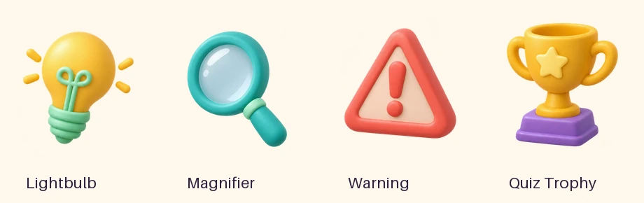
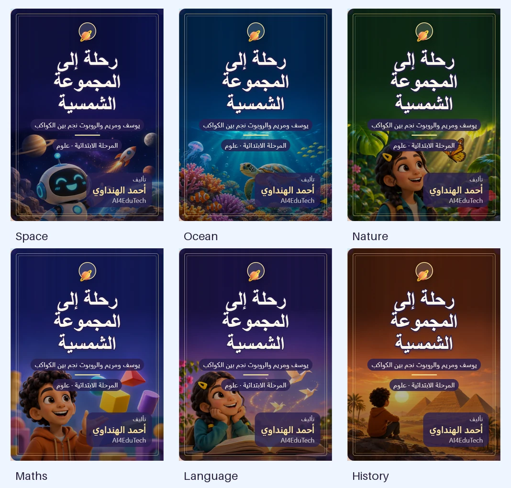

# MorphBook 📖

**Interactive flipbooks whose pages really turn.** Drag a corner and the paper curls along a real fold, hard covers swing open in 3D, the paper rustles, and right-to-left Arabic books turn the right way. One HTML file per book, works offline, no account, no server.

<p dir="rtl"><b>كتب تفاعلية بتتقلّب بجد.</b> اسحب طرف الصفحة وهتتطوي زي الورق الحقيقي، الغلاف بيتفتح ثلاثي الأبعاد، وفيه صوت تقليب ورق، والكتب العربي بتتقلّب من الشمال لليمين صح. كل كتاب ملف HTML واحد بيشتغل من غير نت.</p>

| | |
|---|---|
| **Real page curl** | The page folds along the perpendicular bisector of the grabbed corner and your pointer: `clip-path` + one rigid CSS `matrix()` + gradient shadows. Not a slide, not a canvas, so text stays selectable and sharp. |
| **3D hard covers** | Covers turn with `rotateY` in `preserve-3d`, with a gloss sheen and a board "thock". |
| **Every way to turn** | Drag any corner (with velocity flicks), tap an edge, swipe, arrows, keyboard, the scrubber, or the contents page. Corners peek when the mouse is near. |
| **Arabic first** | `dir: "rtl"` mirrors the whole book: binding on the right, forward drag from the left page, `ar-EG` read-aloud voice. |
| **Paper sound** | Synthesized with Web Audio (noise through a sweeping band-pass, plus a landing), so there is no audio file. Or point `meta.sound.url` at your own clip. |
| **Morph jumps** | Jumping far (contents, scrubber, Home/End) uses the View Transitions API: the spread swings out and the new one swings in. |
| **Teaching built in** | Glossary pop-ups (`.term`), activities, callouts, dialogue, a contents page that jumps, read-aloud, an end-of-book quiz with sound and a score badge. |
| **PDF to flipbook** | `dist/studio.html`: drop a PDF or page images, preview it as a book, download one HTML file. Nothing is uploaded. |
| **Responsive** | Two-page spreads on wide screens, one page on phones; content scales to fill the paper. Print gives clean pages. |

## Try it

- `dist/index.html` → the shelf (open a book, or the studio)
- `dist/books/marine-life-ar.html` → Arabic, right to left, Egyptian dialogue
- `dist/books/cells-en.html` → English, left to right
- `dist/studio.html` → PDF to flipbook, works by double-click (pdf.js is inlined)

## Make a book

**From a PDF, without code:** open `dist/studio.html`, drop the PDF, choose a theme, download.

**From a PDF, on the command line:**

```bash
pip install pymupdf pillow
python tools/pdf_to_book.py lesson.pdf -o books/lesson --title "My lesson" --theme ocean   # --dir rtl for Arabic
python tools/build_book.py books/lesson/book.json -o dist/lesson.html
```

**Written from scratch (what the skill does):** write a `book.json` (see [docs/book-json.md](docs/book-json.md)), then

```bash
python tools/build_book.py my-book/book.json -o dist/my-book.html
python tools/test_book.py dist/my-book.html     # every spread on a laptop and a phone, drag test, quiz, errors
```

`python tools/build_all.py` rebuilds every example, the studio and the shelf.

## Studio theme

Choose **Studio** in the flipbook editor or add `"themePack": "studio"` to a book's metadata.
The demo at `dist/books/studio-demo.html` shows the Arabic solar-system lesson with character dialogue,
illustrated covers, and the game-show quiz. The cover art, badges, and avatars ship inside the exported book.

[Studio cover options](themes/studio/README.md) · [Watch the demo](docs/img/studio-demo.webm)





## The skill

`skill/morphbook/` is an agent skill (Claude Code, Codex, Claude app). It **interviews the teacher** (source, class, language and dialect, story and characters, interactivity, look and sound, credits), writes the book with narrative techniques (hooks, characters, dialogue, cliffhangers, key terms, activities), builds it with the tools above, tests it in a browser and delivers one HTML file. See [skill/morphbook/SKILL.md](skill/morphbook/SKILL.md).

## Repository

```
engine/        morphbook.js + morphbook.css   the reader (no dependencies)
templates/     book.html                       the single-file shell
tools/         build_book.py  pdf_to_book.py  test_book.py  build_studio.py  build_all.py
studio/        studio.src.html                 PDF → flipbook studio (built into dist/studio.html)
examples/      marine-life-ar/  cells-en/      book.json sources
skill/         morphbook/                      the agent skill (interview → build → test → deliver)
docs/          book-json.md  techniques.md  codex-prompts.md
vendor/pdfjs/  pdf.js 3.11.174 (Apache-2.0), loaded with isEvalSupported:false
dist/          built files, ready to open or host (GitHub Pages builds this too)
```

## Use in your own page

```html
<link rel="stylesheet" href="engine/morphbook.css">
<div id="book" style="height:100vh"></div>
<script src="engine/morphbook.js"></script>
<script>
  const book = MorphBook.mount('#book', bookData, { restore: true });
  // book.next(), book.prev(), book.goPage(5), book.startQuiz(), book.destroy()
</script>
```

## Credits and licence

MIT. pdf.js is © Mozilla, Apache-2.0 (`vendor/pdfjs/LICENSE`). The fold geometry follows the classic reflection page-turn technique used by page-flip libraries such as StPageFlip; MorphBook is its own implementation. The teacher-interview flow and saved-brief idea were inspired by [Papermorph](https://github.com/DozenTwelve/Papermorph) (MIT). Built for teachers by AI4EduTech.
